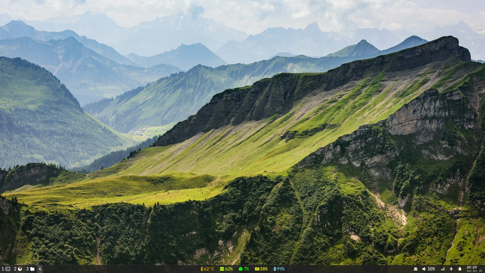
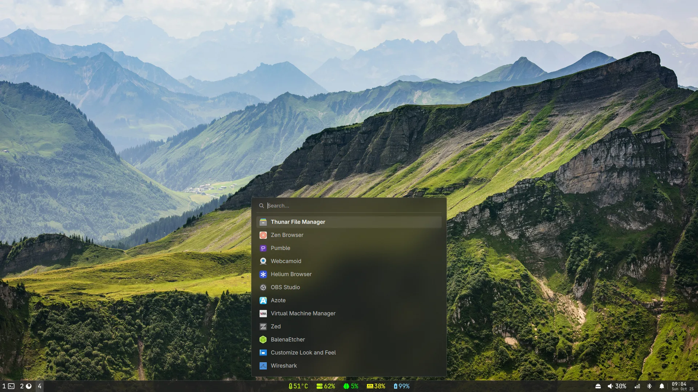
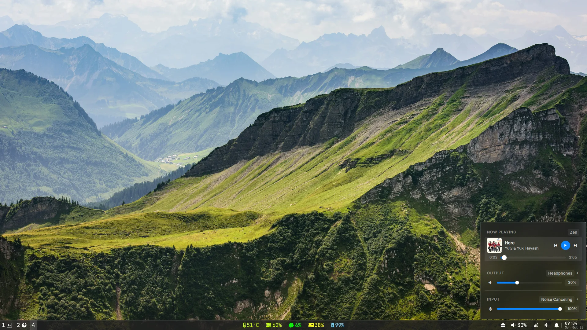
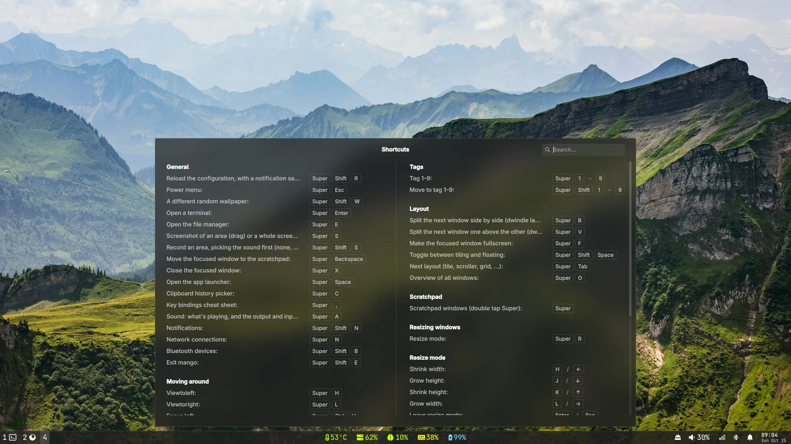
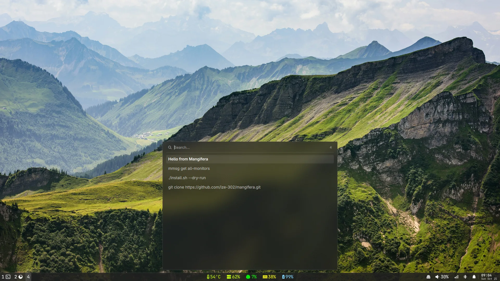
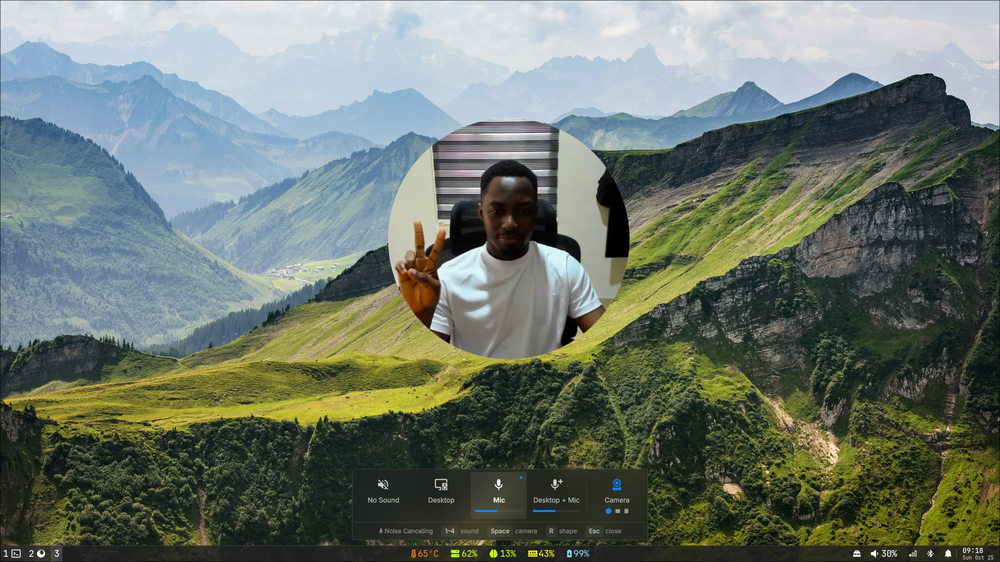
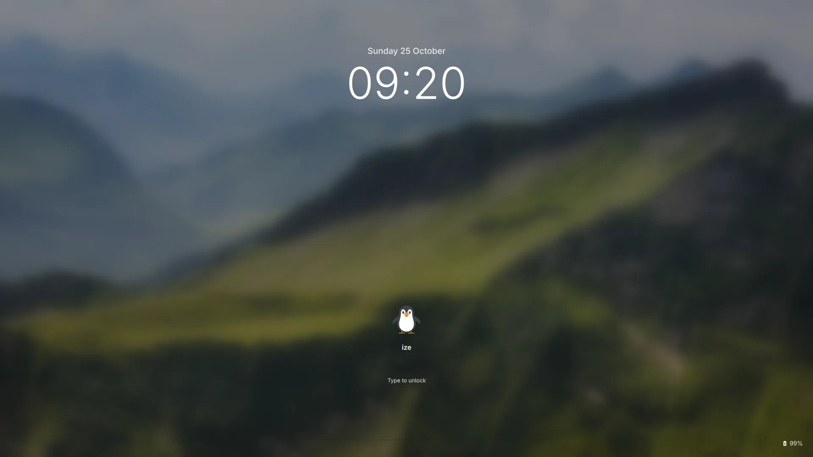

# Mangifera

A clean, frosted-glass [mango](https://github.com/DreamMaoMao/mangowc)
desktop for Arch Linux, with a [Quickshell](https://quickshell.org) bar and
shell.



## Features

<table>
  <tr>
    <td width="50%"><br>Search and open apps</td>
    <td width="50%"><br>Wi-Fi, Bluetooth, sound and brightness in one panel</td>
  </tr>
  <tr>
    <td><br>Notification center</td>
    <td><br>Every shortcut, one key away</td>
  </tr>
  <tr>
    <td><br>Clipboard history</td>
    <td><br>Screen recording, with an optional camera overlay</td>
  </tr>
  <tr>
    <td><br>Lock screen</td>
    <td></td>
  </tr>
</table>

Also: screenshots, an overview of all your windows, a matching login
screen, a noise-canceling mic, a pomodoro timer in the bar, scratchpad
windows, and Bluetooth audio that switches over as soon as it connects.

## Install

You need Arch Linux and a user with sudo.

```sh
git clone https://github.com/ize-302/mangifera.git ~/mangifera
cd ~/mangifera
./install.sh
```

Then log in to mango from the login screen.

Good to know:

- **Keep `~/mangifera` where it is.** Your configs link into it, so moving
  or deleting it breaks the desktop.
- **Your files are safe.** Anything in the way is moved to
  `~/.mangifera-backup-<time>/`, and `./uninstall.sh` puts it back.
- **It updates your system.** Installing packages runs `pacman -Syu`.
  Run `./install.sh --dry-run` first to see what it will do.

## Shortcuts

Press **Super+,** to see them all.

| Keys | Does |
|---|---|
| Super+Space | Open apps |
| Super+Return | Terminal |
| Super+E | Files |
| Super+X | Close window |
| Super+1–9 | Go to workspace |
| Super+Shift+1–9 | Move window to workspace |
| Super+Arrows | Focus another window |
| Super+Shift+Arrows | Move window |
| Super+F | Fullscreen |
| Super+O | Overview |
| Super+A | Control panel |
| Super+Shift+N | Notifications |
| Super+C | Clipboard history |
| Super+S | Screenshot |
| Super+Shift+S | Record the screen |
| Super+Escape | Lock, log out, restart or shut down |

## Make it yours

**Wallpapers:** put images in `~/Pictures/wallpapers`, then press
Super+Shift+W for a random one. It stays after you log out, and the login
screen uses it too.

**Displays, keyboard and extra shortcuts:** add them to
`~/.config/mango/local.conf`. For example:

```
monitor_rule=name:DP-2,x:0,y:0
monitor_rule=name:eDP-1,x:1920,y:0,scale:1.4
xkb_rules_layout=us,de
```

Run `mmsg get all-monitors` to find your display names. Press
Super+Shift+R to reload.

## Update

```sh
cd ~/mangifera
git pull
./install.sh
```

Check [CHANGELOG.md](CHANGELOG.md) first: some updates list steps for you.

## Uninstall

```sh
~/mangifera/uninstall.sh
```

This removes Mangifera and puts back your old files. Packages and your
`local.conf` stay.

## Details

<details>
<summary>What the installer does</summary>

- Installs the packages listed in `install.sh` (all from the official
  repos), upgrading the system with `pacman -Syu`.
- Links `config/` into `~/.config` and `home/` into `~`.
- Installs the SDDM login theme and enables SDDM. If another login manager
  is enabled, it's left alone and the installer prints how to switch.
- Enables Bluetooth and the noise-canceling mic, and makes Thunar the file
  manager.
- Keeps an existing `~/.config/tmux`.
- Doesn't enable NetworkManager, because switching network services could
  cut your connection. It warns you if it's off.
- Asks you to back up your system before changing anything.

It's safe to run again.

</details>

<details>
<summary>Installer options</summary>

| Option | Does |
|---|---|
| `--dry-run` | Show what it would do, change nothing |
| `--no-packages` | Skip installing packages |
| `--yes` | Don't ask about backing up first |

</details>

<details>
<summary>What uninstall undoes</summary>

It undoes only what the installer changed:

- Removes the links and puts back files from `~/.mangifera-backup-*`.
  Anything that would overwrite a file stays in the backup.
- Disables SDDM, but only if the installer enabled it.
- Restores your previous file manager.
- Removes the login theme, unless other users still have Mangifera
  installed.

Packages, Bluetooth and `local.conf` stay.

</details>

<details>
<summary>Scaling the login screen</summary>

The login screen runs its own mango (`/etc/sddm/mango.conf`) and ignores
`local.conf`. To scale it, create `/etc/sddm.conf.d/scale.conf`:

```
[General]
GreeterEnvironment=QT_SCREEN_SCALE_FACTORS=eDP-1=1.4;DP-2=1
```

</details>

<details>
<summary>Several users on one machine</summary>

Each user who runs the installer joins the `mangifera` group, which lets
them set the login screen's wallpaper (from their next login).

</details>

## License

[MIT](LICENSE)
