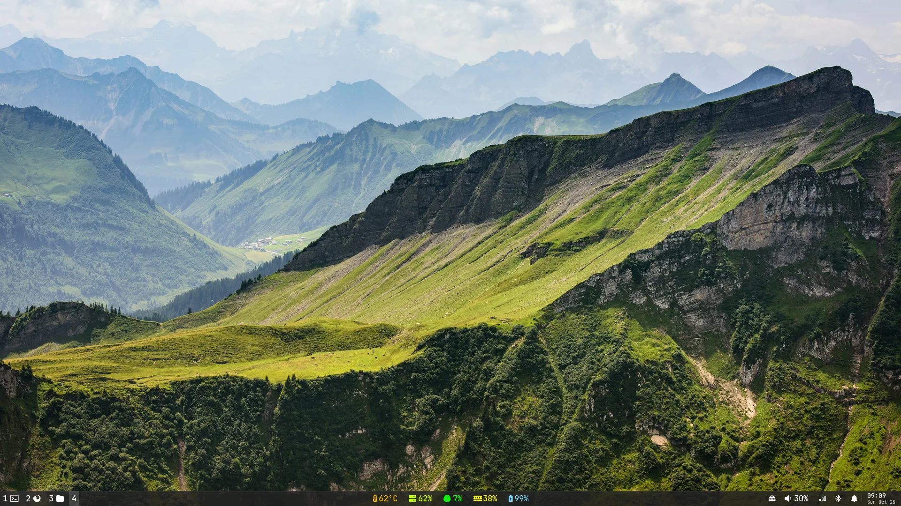
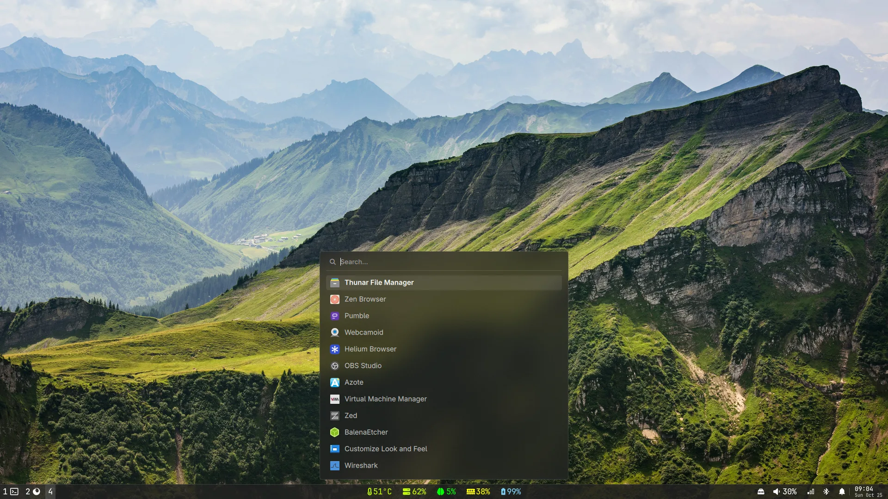
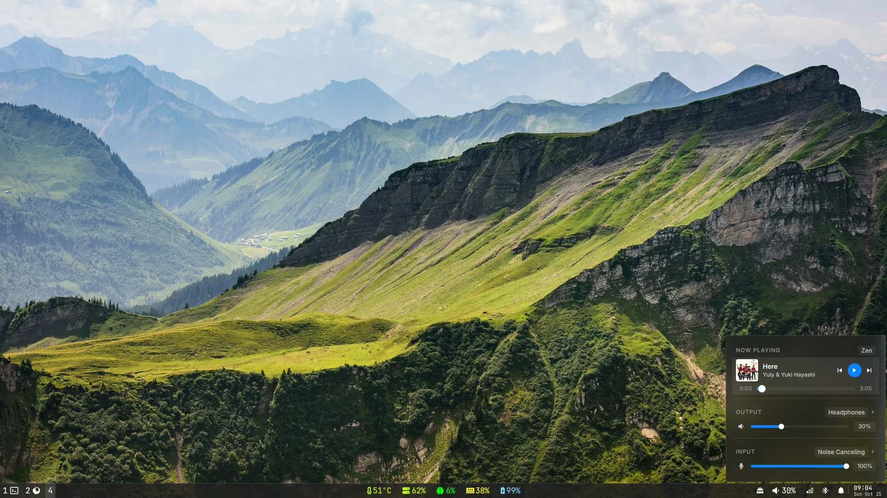
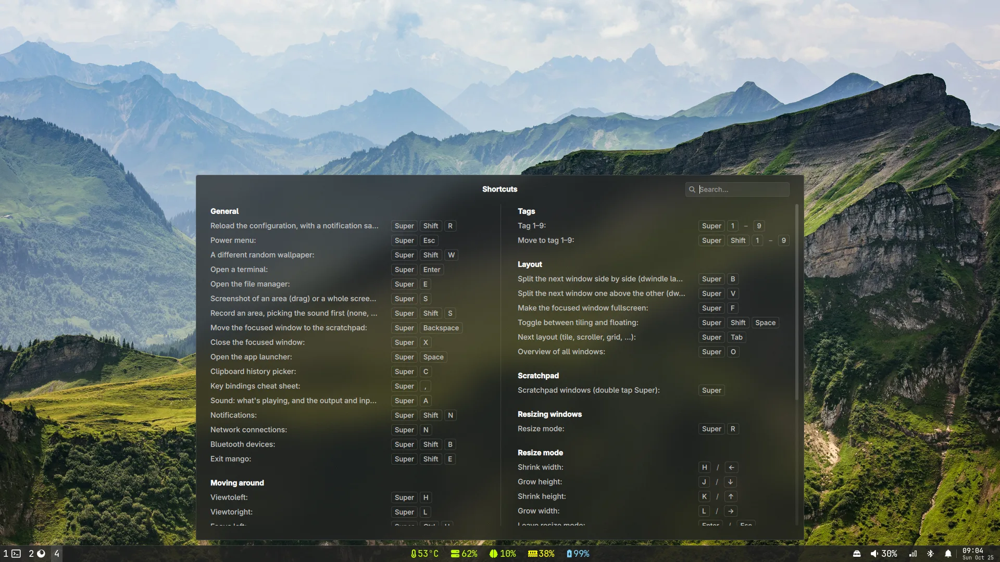
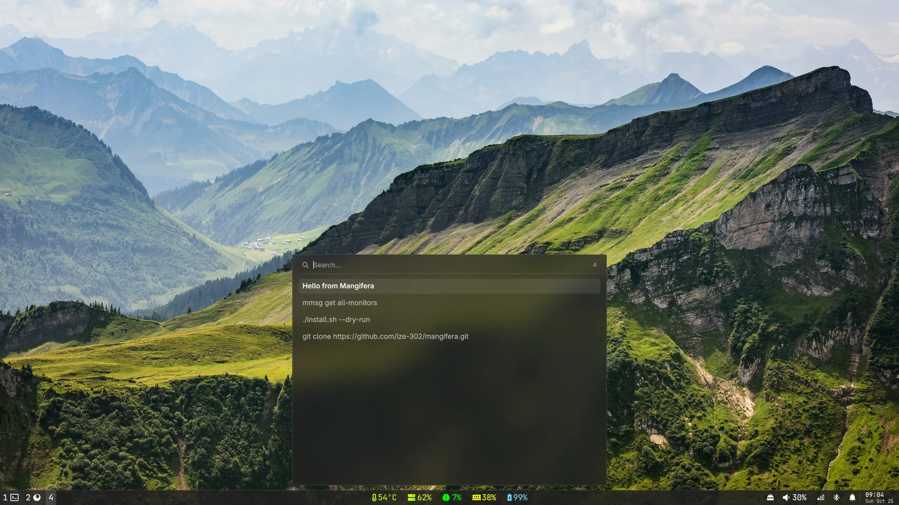
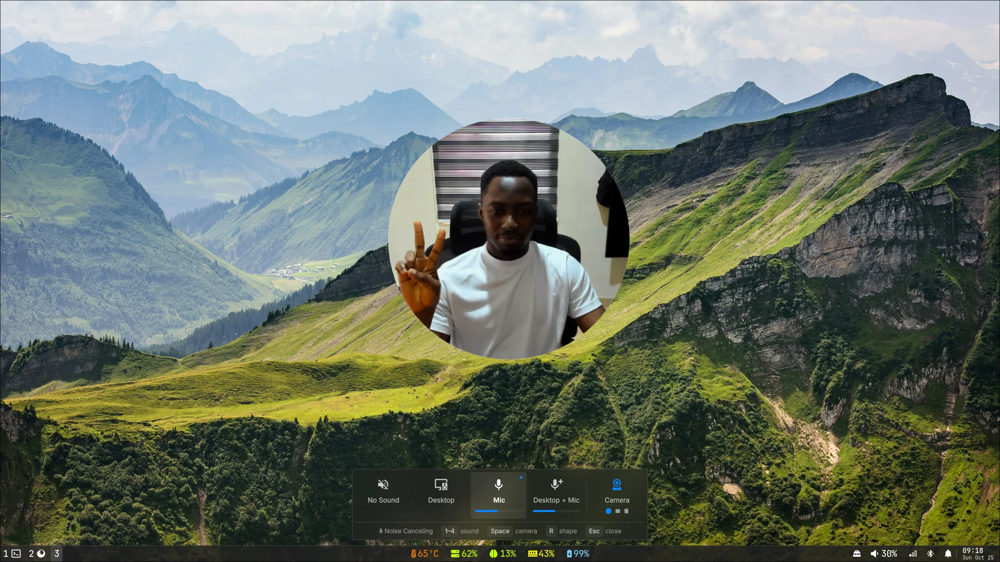
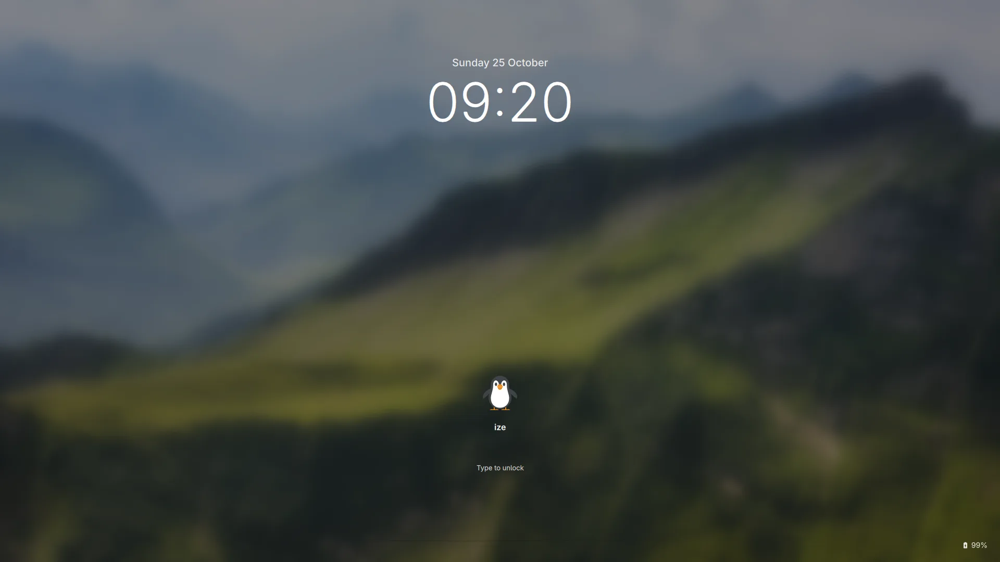

# Mangifera

A clean, frosted-glass [mango](https://github.com/DreamMaoMao/mangowc)
desktop for Arch Linux, with a [waybar](https://github.com/Alexays/Waybar)
bar and a [Quickshell](https://quickshell.org) shell.



## Features

<table>
  <tr>
    <td width="50%"><br>Search and open apps</td>
    <td width="50%"><br>Wi-Fi, Bluetooth, sound and brightness in one panel</td>
  </tr>
  <tr>
    <td><br>Notification center</td>
    <td><br>Every shortcut, one key away</td>
  </tr>
  <tr>
    <td><br>Clipboard history</td>
    <td><br>Screen recording, with an optional camera overlay</td>
  </tr>
  <tr>
    <td><br>Lock screen</td>
    <td></td>
  </tr>
</table>

Also: screenshots, an overview of all your windows, a matching login
screen, a noise-canceling mic, a pomodoro timer in the bar, scratchpad
windows, Bluetooth audio that switches over as soon as it connects, and USB
drives that mount when plugged in, with Open and Eject in the notification.

## Install

You need Arch Linux and a user with sudo.

```sh
git clone https://github.com/ize-302/mangifera.git ~/mangifera
cd ~/mangifera
./install.sh
```

Then log in to mango from the login screen.

Good to know:

- **Keep `~/mangifera` where it is.** Your configs link into it, so moving
  or deleting it breaks the desktop.
- **Your files are safe.** Anything in the way is moved to
  `~/.mangifera-backup-<time>/`, and `./uninstall.sh` puts it back.
- **It updates your system.** Installing packages runs `pacman -Syu`.
  Run `./install.sh --dry-run` first to see what it will do.

## Shortcuts

Press **Super+,** to see them all.

| Keys | Does |
|---|---|
| Super+Space | Open apps |
| Super+Return | Terminal (`$TERMINAL`) |
| Super+E | Files |
| Super+X | Close window |
| Super+1–9 | Go to workspace |
| Super+Shift+1–9 | Move window to workspace |
| Super+Arrows | Focus another window |
| Super+Shift+Arrows | Move window |
| Super+F | Fullscreen |
| Super+O | Overview |
| Super+A | Control panel |
| Super+Shift+N | Notifications |
| Super+C | Clipboard history |
| Super+M | Notes |
| Super+S | Screenshot |
| Super+Shift+S | Record the screen |
| Super+Escape | Lock, log out, restart or shut down |

## Make it yours

**Wallpapers:** put images in `~/Pictures/wallpapers`, then press
Super+Shift+W for a random one. It stays after you log out, and the login
screen uses it too.

**Displays, keyboard and extra shortcuts:** add them to
`~/.config/mango/local.conf`. For example:

```
monitor_rule=name:DP-2,x:0,y:0
monitor_rule=name:eDP-1,x:1920,y:0,scale:1.4
xkb_rules_layout=us,de
```

Run `mmsg get all-monitors` to find your display names. Press
Super+Shift+R to reload.

**Terminal:** Super+Return, the app launcher, Thunar's terminal actions and
btop open `$TERMINAL`. Set it in `~/.config/mango/local.conf`:

```
env=TERMINAL,kitty
```

foot, kitty, alacritty, wezterm and ghostty are known. Another terminal works
too, but can't run btop. With `$TERMINAL` unset, the first installed one of
those opens (install.sh installs foot). mangifera ships no terminal config:
keep yours in your own dotfiles.

**Face unlock:** with an IR camera (most Windows Hello webcams and many
laptops), the lock screen can unlock when it sees your face. Install
[howdy](https://github.com/boltgolt/howdy) 3 (from source or the AUR's
`howdy-beta-git`), set `device_path` in `/etc/howdy/config.ini` to the IR
camera, then run `sudo howdy add`. The lock looks for you when the password
field shows; press Enter on the empty field to look again. Your password
always works too. Only the lock screen uses it: login and `sudo` stay
password-only.

*More than one IR camera* (say a laptop's own and a webcam you plug in):
howdy takes one `device_path`, so give it a udev link that follows whichever
camera is there. Find each IR camera's node with
`for d in /dev/video*; do echo "$d $(cat /sys/class/video4linux/${d#/dev/}/name)"; done`,
then read its vendor, product and index with
`udevadm info -a -n /dev/videoN | grep -E 'ATTR\{(name|index)\}|ATTRS\{id(Vendor|Product)\}'`.
Put one line per camera in `/etc/udev/rules.d/90-howdy-ir.rules`. The highest
`link_priority` wins while plugged in. This example prefers a Logitech BRIO
and falls back to a laptop's built-in IR:

```
SUBSYSTEM=="video4linux", ATTRS{idVendor}=="046d", ATTRS{idProduct}=="085e", ATTR{index}=="2", SYMLINK+="howdy-ir", OPTIONS+="link_priority=10"
SUBSYSTEM=="video4linux", ATTRS{idVendor}=="13d3", ATTRS{idProduct}=="5405", ATTR{index}=="0", SYMLINK+="howdy-ir", OPTIONS+="link_priority=0"
```

Then load it and point howdy at the link:

```sh
sudo udevadm control --reload
sudo udevadm trigger --subsystem-match=video4linux
sudo sed -i 's|^device_path = .*|device_path = /dev/howdy-ir|' /etc/howdy/config.ini
```

Run `sudo howdy add` once with each camera active (unplug the preferred one
for the other), since a face learned on one sensor may not match on another.

Face unlock is a convenience, not a strong lock. Someone who looks like you,
or who holds the laptop up to you while you sleep, can unlock it.

## Update

```sh
cd ~/mangifera
git pull
./install.sh
```

Check [CHANGELOG.md](CHANGELOG.md) first: some updates list steps for you.

## Uninstall

```sh
~/mangifera/uninstall.sh
```

This removes Mangifera and puts back your old files. Packages and your
`local.conf` stay.

## Details

<details>
<summary>What the installer does</summary>

- Installs the packages listed in `install.sh` (all from the official
  repos), upgrading the system with `pacman -Syu`.
- Links `config/` into `~/.config` and `home/` into `~`.
- Installs the SDDM login theme and enables SDDM. If another login manager
  is enabled, it's left alone and the installer prints how to switch.
- Enables Bluetooth and the noise-canceling mic, and makes Thunar the file
  manager.
- Keeps an existing `~/.config/tmux`.
- Doesn't enable NetworkManager, because switching network services could
  cut your connection. It warns you if it's off.
- Asks you to back up your system before changing anything.

It's safe to run again.

</details>

<details>
<summary>Installer options</summary>

| Option | Does |
|---|---|
| `--dry-run` | Show what it would do, change nothing |
| `--no-packages` | Skip installing packages |
| `--yes` | Don't ask about backing up first |

</details>

<details>
<summary>What uninstall undoes</summary>

It undoes only what the installer changed:

- Removes the links and puts back files from `~/.mangifera-backup-*`.
  Anything that would overwrite a file stays in the backup.
- Disables SDDM, but only if the installer enabled it.
- Restores your previous file manager.
- Removes the login theme, unless other users still have Mangifera
  installed.

Packages, Bluetooth and `local.conf` stay.

</details>

<details>
<summary>Scaling the login screen</summary>

The login screen runs its own mango (`/etc/sddm/mango.conf`) and ignores
`local.conf`. To scale it, create `/etc/sddm.conf.d/scale.conf`:

```
[General]
GreeterEnvironment=QT_SCREEN_SCALE_FACTORS=eDP-1=1.4;DP-2=1
```

</details>

<details>
<summary>Several users on one machine</summary>

Each user who runs the installer joins the `mangifera` group, which lets
them set the login screen's wallpaper (from their next login).

</details>

## License

[MIT](LICENSE)
